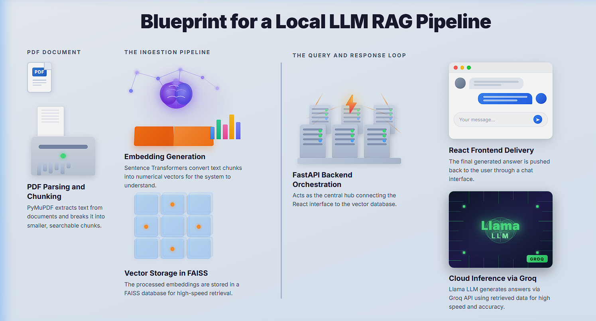
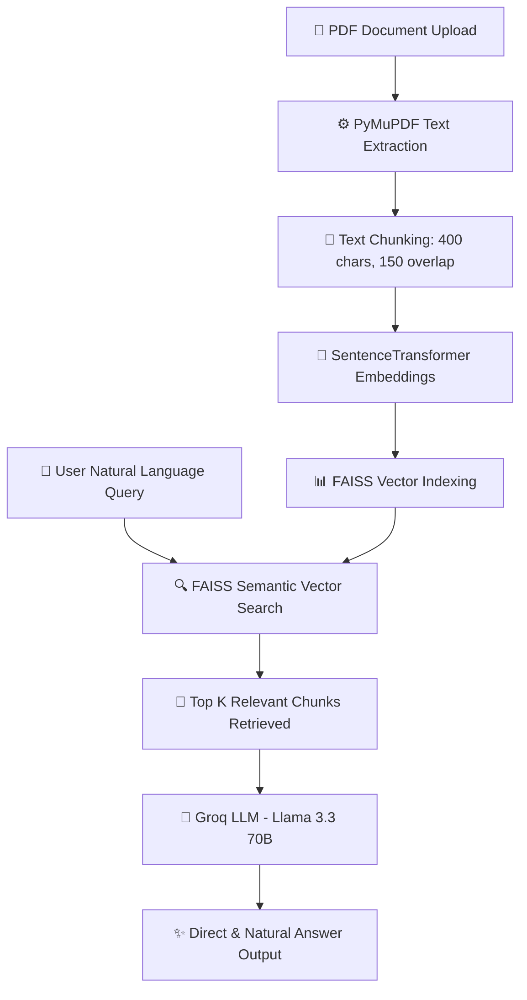

# 🧠 Documind — RAG Document QA System



**Documind** is a powerful Retrieval-Augmented Generation (RAG) system designed for intelligent document interaction. It allows users to upload PDF documents and receive natural, context-aware answers to complex queries using high-performance vector search and state-of-the-art Large Language Models.

---

## 🚀 Tech Stack & Core Technologies

### **Backend**
* **Framework**: [FastAPI](https://fastapi.tiangolo.com/) (Python)
* **PDF Extraction**: [PyMuPDF (`fitz`)](https://pymupdf.readthedocs.io/)
* **Vector Store**: [FAISS](https://github.com/facebookresearch/faiss) (Facebook AI Similarity Search)
* **Embeddings**: [SentenceTransformers](https://www.sbert.net/) (`all-MiniLM-L6-v2`)
* **LLM Engine**: [Groq API](https://groq.com/) (`llama-3.3-70b-versatile`)
* **Environment Management**: `python-dotenv`

### **Frontend**
* **Framework**: [React.js](https://reactjs.org/)
* **Styling**: Modern CSS with glassmorphism & responsive chat interface
* **HTTP Client**: `fetch` API

---

## ⚡ Workflow Architecture



---

## ✨ Features

* 📄 **Seamless PDF Ingestion**: Extract clean text from uploaded PDFs instantly.
* 🧩 **Smart Text Chunking**: Splits document text into overlapping chunks (400 characters with 150 character overlap) to preserve context continuity.
* 🔍 **Fast Vector Search**: Leverages L2 Euclidean distance indexing with FAISS to retrieve top matching contexts.
* 🤖 **Human-like Conversational QA**: Configured with strict system prompts to provide direct, natural answers without jargon like *"chunk"* or *"context"*.
* 🎨 **Interactive User Interface**: Simple PDF uploader and real-time chat interface built with React.

---

## 📁 Repository Structure

```text
Documind/
├── RAG_Workflow_Pipeline.png   # Workflow Architecture Diagram
├── .gitignore                  # Git ignore configuration
├── README.md                   # Project documentation
├── backend/
│   ├── main.py                 # FastAPI application server & routes
│   ├── ingest.py               # PDF loading and chunking utilities
│   ├── vector_store.py         # FAISS index creation and similarity search
│   ├── rag.py                  # Groq LLM integration and prompt logic
│   ├── requirements.txt        # Python package dependencies
│   ├── .env.example            # Environment variables template
│   └── data/                   # Uploaded PDF storage directory
└── frontend/
    ├── public/                 # Static web assets
    ├── src/
    │   ├── App.js              # Main React application component
    │   ├── UploadPDF.js        # PDF upload component
    │   ├── ChatBox.js          # Chat interface component
    │   └── ChatBox.css         # Styling for chat box
    ├── package.json            # Node.js dependencies and scripts
    └── .gitignore              # Frontend git ignore configuration
```

---

## 🛠️ Installation & Setup Guide

### **Prerequisites**
* **Python 3.10+** installed
* **Node.js 16+** and `npm` installed
* **Groq API Key** (Get one at [console.groq.com](https://console.groq.com/))

---

### **1. Backend Setup**

```bash
# Navigate to the backend directory
cd backend

# Create a virtual environment
python -m venv venv

# Activate the virtual environment
# On Windows:
venv\Scripts\activate
# On macOS/Linux:
source venv/bin/activate

# Install dependencies
pip install -r requirements.txt

# Create a .env file from the template
cp .env.example .env
```

Open `.env` and add your Groq API key:
```env
GROQ_API_KEY=gsk_your_actual_groq_api_key_here
```

Start the FastAPI backend server:
```bash
uvicorn main:app --reload
```
> The API server will run at: **`http://127.0.0.1:8000`**

---

### **2. Frontend Setup**

Open a new terminal window:

```bash
# Navigate to the frontend directory
cd frontend

# Install Node dependencies
npm install

# Start the React development server
npm start
```
> The web application will open automatically at: **`http://localhost:3000`**

---

## 🔌 API Endpoints Reference

### **1. Upload PDF**
* **URL**: `/upload-pdf`
* **Method**: `POST`
* **Payload**: `multipart/form-data` with `file` field containing the PDF.
* **Response**:
```json
{
  "message": "PDF uploaded successfully"
}
```

---

### **2. Chat Query**
* **URL**: `/chat`
* **Method**: `POST`
* **Query Parameter**: `query` (string)
* **Response**:
```json
{
  "answer": "Synthesized natural answer from LLM based on document context."
}
```

---
👩‍💻 Author

Tejal Bari

GitHub: @TejalBari05

## 🛡️ License

This project is open source and available under the [MIT License](LICENSE).
